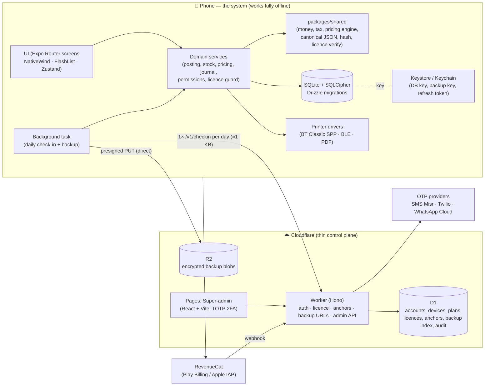
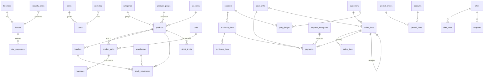
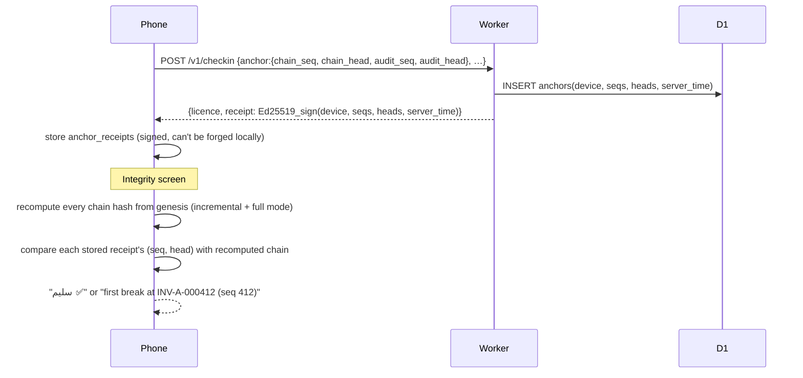
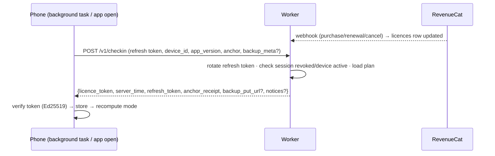
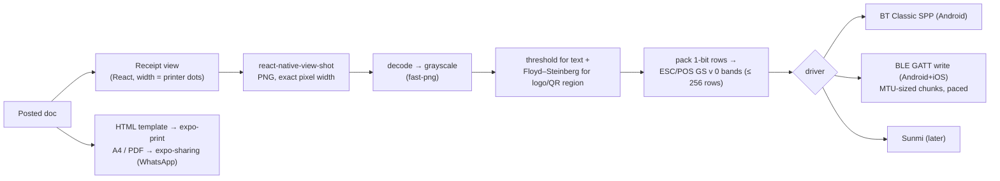

# PLAN.md — Offline-first Arabic POS (Phase 0)

> Status: **v2 — owner answers to Phase 0 questions applied (see §17).** Waiting for "continue" to start Phase 1.
> Source of truth: `SPEC.md`. This file explains *how* the spec will be built, and lists every place where
> I propose to deviate from it or fill a gap the spec leaves open (§13) and the questions I need answered (§15).

Contents
1. Architecture overview
2. Monorepo layout & folder map
3. Mobile app architecture (layers, DB, lock, i18n, design system)
4. Data model (ERD, tables, key fields, indexes)
5. Money, quantity, tax & rounding rules
6. Stock ledger rules
7. Posting, immutability, hash chain, audit log, anchoring
8. Licence flow (Ed25519, offline grace, clock rollback)
9. Backup / restore / new phone flow
10. Printing pipeline
11. Server: endpoints & request budget per business per day
12. Security model (what we protect, what we cannot)
13. Decisions & deviations from SPEC.md
14. Risks
15. Phased roadmap with acceptance criteria
16. Open questions

---

## 1. Architecture overview



Key properties
- **The server never sees business data.** It stores: phone numbers, business name/country/type, plan &
  licence state, device list, *hashes* (anchors), and opaque encrypted backup blobs.
- **One daily call.** Licence refresh, integrity anchor, session-revocation check, refresh-token rotation
  and "give me a backup upload URL" are folded into one `POST /v1/checkin` (see §11, D-02).
- **The Worker never streams files.** Backups go phone ⇄ R2 with presigned URLs.
- **Shared code is pure TypeScript** (no React Native, no Workers APIs) so it is tested once with Vitest
  and used identically on phone and server (e.g. licence payload schema, canonical JSON, money).

---

## 2. Monorepo layout & folder map

Tooling: **pnpm workspaces + Turborepo**, TypeScript strict everywhere, ESLint + Prettier, Changesets not
needed (apps are not published packages). Node 22 LTS.

```
/
├─ SPEC.md, PLAN.md, SECURITY.md, README.md
├─ docs/                         # mandatory docs, updated with every phase (see §15)
├─ apps/
│  ├─ mobile/                    # Expo app (dev builds via EAS)
│  │  ├─ app/                    # Expo Router routes ONLY (thin screens)
│  │  │  ├─ (auth)/              # phone, otp, onboarding
│  │  │  ├─ (locked)/            # lock screen, user switch
│  │  │  └─ (main)/              # tabs: home, pos, products, parties, more
│  │  ├─ src/
│  │  │  ├─ db/                  # schema.ts (Drizzle), migrations/, client.ts (SQLCipher open), triggers.sql
│  │  │  ├─ domain/              # business logic per module (no React):
│  │  │  │  ├─ sales/ purchases/ stock/ parties/ cash/ journal/ offers/
│  │  │  │  ├─ posting/          # the ONLY place that posts documents (tx + chain + journal + ledger)
│  │  │  │  ├─ integrity/        # chain verify, audit log, anchors
│  │  │  │  ├─ licence/          # verify, guard (canWrite), clock guard
│  │  │  │  └─ auth/             # users, roles, PIN, permissions
│  │  │  ├─ features/            # React screens/components per module (use domain via hooks)
│  │  │  ├─ ui/                  # design system: tokens, Text, Button, Card, Sheet, Field, Icon, ...
│  │  │  ├─ printing/            # drivers (spp, ble, pdf), raster encoder, receipt views, templates
│  │  │  ├─ backup/              # snapshot, codec bridge, upload/download, restore
│  │  │  ├─ api/                 # typed client for the Worker (zod-validated)
│  │  │  ├─ i18n/                # ar.json (default), en.json, country/type copy overlays
│  │  │  └─ state/               # Zustand stores (UI state only — DB is the source of truth)
│  │  ├─ modules/                # local Expo native modules (see D-04): backup-codec, (bt-spp if needed)
│  │  └─ e2e/                    # Maestro flows
│  ├─ api/                       # Cloudflare Worker (Hono) + D1 migrations + wrangler.toml
│  │  └─ src/{routes,auth,otp,licence,backup,admin,billing,lib}/
│  └─ admin/                     # React + Vite super-admin (Cloudflare Pages)
└─ packages/
   ├─ shared/                    # pure TS: money, rounding, tax, pricing engine, canonical JSON, sha256,
   │                             #   uuidv7, HLC, licence payload + verify, zod API schemas, country profiles
   └─ config/                    # shared tsconfig / eslint presets
```

"What links to what": `app/*` routes → `features/*` components → `domain/*` services → `db/*` +
`packages/shared`. Nothing in `features/` writes to the DB directly; nothing in `domain/` imports React.
This rule is enforced with an ESLint `no-restricted-imports` boundary.

---

## 3. Mobile app architecture

### 3.1 Startup & unlock (target cold start < 2 s)
1. Native splash → read DB key from SecureStore (`AFTER_FIRST_UNLOCK_THIS_DEVICE_ONLY`, so the background
   backup task can open the DB while the phone is locked-but-unlocked-since-boot).
2. `openDatabaseSync(name)` → `PRAGMA key = "x'<64 hex>'"` → `PRAGMA cipher_memory_security = OFF`
   (perf) → run pending Drizzle migrations (bundled SQL) → `PRAGMA foreign_keys = ON`, `journal_mode = WAL`.
3. Verify cached licence token offline (Ed25519, < 5 ms) → compute app mode (full / grace / read-only).
4. Show **lock screen** (user tiles; PIN pad; biometric button for users who enabled it).
5. Home renders from small indexed queries; heavy aggregates load after first paint.

### 3.2 Lock, users, roles
- Users live in the local DB. PIN (4–6 digits) stored as `scrypt(pin, salt)` (N tuned to ~150 ms on a
  mid-range phone) — never plain. Wrong-PIN back-off: 5 tries → 30 s, then doubling, max 15 min.
- Biometrics (`expo-local-authentication`) is an *optional shortcut* per user (default: Owner only).
- Auto-lock: `AppState` + inactivity timer (default 5 min, setting) → back to lock screen; quick user switch
  from the header avatar (2 taps + PIN).
- Honest note: the lock is an **app-level** gate. The DB key is protected by the OS keystore, not by the
  PIN (otherwise background backup and PIN-only cashiers could not open the DB). See §12.
- Roles: `Owner`, `Manager`, `Cashier` (system, not deletable) + custom roles. Permissions are a flat set
  of string keys (`price.change`, `discount.max_bp`, `doc.void`, `cost.view`, `profit.view`,
  `stock.adjust`, `report.<name>`, `settings.*`, `users.manage`, …). Checked in **domain services**
  (not only by hiding buttons); every check that blocks an action is visible to the user with a
  "ask the manager" PIN-override sheet (manager enters PIN → action allowed and audit-logged).

### 3.3 Layers & state
- **DB is the source of truth.** Zustand only for UI state (current cart, filters, lock state).
- Reads: small hooks over Drizzle queries with explicit invalidation keys after writes (a tiny
  event bus `db.changed('products')`), no heavyweight cache library needed.
- Writes: `domain/*` functions, each in **one SQLite transaction** (`withTransactionAsync`).
- Long lists: FlashList + keyset pagination (`WHERE (sort_key,id) < (?,?) LIMIT 50`), never OFFSET.
- Search: SQLite **FTS5** virtual tables for products/customers/suppliers (Arabic normalisation done in
  JS before indexing & querying: strip tashkeel/tatweel, unify أ/إ/آ→ا, ة→ه, ى→ي, Arabic-Indic → Latin
  digits). Barcode lookups via a unique index (exact match, O(log n)).

### 3.4 i18n, RTL, typography
- i18next + `expo-localization`; Arabic default, English second. `app.json` `extra.supportsRTL/forcesRTL`
  per language; switching language triggers a reload (RN RTL requirement).
- All layout uses **logical** NativeWind classes (`ps-`, `pe-`, `ms-`, `me-`, `start-`, `end-`).
- Copy is layered: `base` → `country (EG|SA)` → `business type (shop|trading)`. Example: wallet labels
  ("فودافون كاش / إنستاباي" vs "STC Pay"), tax label, invoice title ("فاتورة ضريبية مبسطة" for SA).
- Font: IBM Plex Sans Arabic (Regular/Medium/SemiBold/Bold) via `expo-font`, embedded at build.
- Numbers: Latin digits by default for clarity in prices/barcodes, with a setting for Arabic-Indic digits
  in display and print (see Q-07).

### 3.5 Design system (no purple, not template-looking)
- Tokens in one file (`ui/tokens.ts`) feeding the Tailwind config: a warm-neutral base (sand/stone),
  primary **TIQNIA blue** (#0F4CC7 / #0866FF, navy #0B1F4D) by default — palette switchable (D-34), semantic green/red/blue; soft 2-layer shadows,
  12–16 px radii, subtle vertical gradients on summary cards only.
- Duotone icon set: a small custom set (SVG, two-tone using `currentColor` + token tint), not a generic
  outline pack, so the app does not look stock.
- Touch targets ≥ 48 dp; primary actions at the bottom (thumb zone); bottom-sheet patterns for forms.
- Tokens are already defined as light/dark pairs so dark mode (Phase 7) is a theme switch, not a rewrite.

### 3.6 Country & type profiles (nothing hardcoded)
`packages/shared/src/profiles/` holds a typed profile per country and per business type:
currency + minor units, default VAT rate & label, VAT-inclusive default, payment methods shown, invoice
titles, receipt template defaults (SA: ZATCA QR on), number/date formats, feature defaults (trading
company: wholesale price tier, credit sales and purchases emphasised; shop: POS-first home). Onboarding
copies the profile into `settings`; everything reads `settings`, so a business can later override.

---

## 4. Data model

### 4.1 Conventions (every table unless noted)
| Column | Type | Note |
|---|---|---|
| `id` | TEXT (UUIDv7) | generated on device; time-ordered → good index locality |
| `created_at`, `updated_at` | INTEGER (epoch ms) | device clock (display/sort only — never for merge) |
| `created_by` | TEXT → users.id | |
| `device_id` | TEXT → devices.id | origin device |
| `hlc` | TEXT | **master data only**: Hybrid Logical Clock `"<ms 13>-<counter 4>-<device code>"`, updated on every change; used later for field-level LWW (multi-device, §8 of SPEC). Not used for logic in v1. |
| `deleted_at` | INTEGER NULL | **master data only** (soft delete + undo) |

- Money: INTEGER minor units, suffix `_minor`. Quantities: INTEGER **milli-units** of the base unit,
  suffix `_milli` (see §5). Rates: INTEGER **basis points** (`_bp`, 1500 = 15 %).
- Dates for reporting: `business_day` INTEGER `yyyymmdd` in the business time zone, stored on every
  posted document and line (denormalised for fast `GROUP BY`).
- Append-only tables are protected by SQLite triggers (`BEFORE UPDATE/DELETE … RAISE(ABORT)`).
- Posted documents: a trigger allows changing **only** `status` (POSTED→VOIDED), `print_count`,
  `last_printed_at`, `shared_at`; any other change aborts.

### 4.2 ERD (core)



### 4.3 Tables (key fields)

**System**
| Table | Key fields |
|---|---|
| `business` (1 row) | server_business_id, name, country `EG|SA`, type `shop|trading`, currency, vat_registered, vat_number, cr_number, address, phones_json, logo_path, timezone |
| `settings` | key PK, value_json (negative-stock policy, VAT-inclusive, rounding, auto-lock, print options, digits…) |
| `devices` | code (`A`,`B`,…, assigned by server), name, platform, is_current, activated_at, deactivated_at |
| `doc_sequences` | (device_id, doc_type) PK, prefix, next_seq |
| `users` | name, role_id, pin_hash, pin_salt, biometric_enabled, is_active, last_login_at |
| `roles` | name, is_system, permissions_json, max_item_discount_bp, max_invoice_discount_bp |
| `licence_state` (1 row) | token, payload_json, verified_at, last_checkin_at, last_server_time, max_seen_time, mode |
| `kv_meta` | schema/app version, last backup, last anchor receipt, etc. |

**Master data** (all have `hlc`, `deleted_at`)
| Table | Key fields |
|---|---|
| `categories` | name, parent_id, sort |
| `units` | name_ar, name_en, allows_fraction (kg yes, piece no) |
| `tax_rates` | name, rate_bp, is_default, zatca_category (S/Z/E/O) |
| `product_groups` | name, attributes_json (e.g. size/colour) — parent for variants |
| `products` | name, name_en, sku, category_id, group_id, variant_json, base_unit_id, tax_rate_id, cost_minor (last purchase cost, per base unit), retail_price_minor, wholesale_price_minor, track_stock, track_expiry, low_stock_milli, image_path, is_active |
| `product_units` | product_id, unit_id, factor_milli (base units per this unit, 1000 = 1), retail_price_minor, wholesale_price_minor, is_default_sale, is_default_purchase |
| `barcodes` | code UNIQUE, product_id, product_unit_id (scanning a carton barcode adds 1 carton) |
| `batches` | product_id, batch_no, expiry_day |
| `warehouses` | name, is_default (one in v1) |
| `customers` | name, mobile, address, email, tax_number, credit_limit_minor, price_tier `retail|wholesale`, payment_terms_days, notes |
| `suppliers` | name, mobile, address, email, tax_number, payment_terms_days, notes |
| `expense_categories` | name, account_id |
| `printers` | name, driver `spp|ble|pdf|sunmi`, address, paper_width `58|80`, dots, is_default, options_json |

**Stock**
| Table | Key fields |
|---|---|
| `stock_movements` (append-only) | product_id, warehouse_id, batch_id, qty_milli (signed, base unit), unit_cost_minor, type `SALE|SALE_RETURN|PURCHASE|PURCHASE_RETURN|ADJUST|COUNT|TRANSFER_IN|TRANSFER_OUT|OPENING|VOID_REVERSAL`, source_type, source_id, source_line_id, reason, business_day, occurred_at |
| `stock_levels` (cache) | (product_id, warehouse_id) PK, qty_milli, avg_cost_minor, value_minor, last_movement_at |
| `batch_levels` (cache) | (batch_id, warehouse_id) PK, qty_milli |
| `inventory_docs` | type `ADJUST|COUNT|OPENING|TRANSFER`, number, status, reason, posted fields (chain) |
| `inventory_lines` | doc_id, product_id, batch_id, expected_milli, counted_milli, delta_milli, unit_cost_minor |

**Commercial documents**
| Table | Key fields |
|---|---|
| `sales_docs` | type `INVOICE|RETURN|QUOTATION`, status `DRAFT|PARKED|POSTED|VOIDED|CONVERTED`, number, seq, device_id, customer_id (NULL = walk-in), price_tier, original_doc_id (returns), shift_id, cashier_id, issued_at, business_day, subtotal_minor, line_discount_minor, doc_discount_minor, tax_minor, rounding_minor, total_minor, paid_minor, credit_minor, coupon_code, notes, hash, prev_hash, chain_seq, posted_at, void_reason, voided_by, voided_at, print_count |
| `sales_lines` | doc_id, line_no, product_id, product_unit_id, batch_id, name_snapshot, qty_milli (in sold unit), factor_milli, base_qty_milli, unit_price_minor, discount_minor, offer_id, discount_reason, tax_rate_bp, net_minor, tax_minor, total_minor, unit_cost_minor (snapshot for profit), business_day |
| `purchase_docs` / `purchase_lines` | same shape (supplier_id, supplier_invoice_no, due_day); lines carry unit_cost_minor |
| `payments` | direction `IN|OUT`, kind `SALE|RECEIPT|REFUND|PURCHASE|SUPPLIER_PAYMENT|SUPPLIER_REFUND|EXPENSE|CASH_IN|CASH_OUT`, method `CASH|CARD|WALLET|BANK|CREDIT_NOTE`, wallet_name, amount_minor, party_type, party_id, doc_type, doc_id (NULL = on account), expense_category_id, shift_id, number, reference, business_day, posted chain fields |
| `party_ledger` (append-only) | party_type `C|S`, party_id, source_type, source_id, debit_minor, credit_minor, business_day, due_day |
| `party_balances` (cache) | (party_type, party_id) PK, balance_minor, last_activity_at |
| `cash_shifts` | number, opened_by, opened_at, opening_float_minor, closed_by, closed_at, expected_cash_minor, counted_cash_minor, difference_minor, note |

**Accounting (background)**
| Table | Key fields |
|---|---|
| `accounts` | code, name_ar, name_en, type `ASSET|LIABILITY|EQUITY|INCOME|EXPENSE`, system_key (CASH, AR, AP, INVENTORY, VAT_OUT, VAT_IN, SALES, SALES_RETURNS, SALES_DISCOUNT, COGS, STOCK_ADJ, CASH_OVER_SHORT, OPENING_EQUITY, …) |
| `journal_entries` (append-only) | source_type, source_id, business_day, memo |
| `journal_lines` (append-only) | entry_id, account_id, debit_minor, credit_minor, party_type, party_id, business_day |

**Offers**
| Table | Key fields |
|---|---|
| `offers` | name, type `PERCENT|FIXED|BUY_X_GET_Y|QTY_PRICE|COUPON`, starts_day, ends_day, priority, stackable, is_active, applies_to_json |
| `offer_rules` | offer_id, product/category scope, min_qty_milli, value_bp / value_minor, get_qty_milli, get_product_id |
| `coupons` | offer_id, code UNIQUE, max_uses, used_count (derived from posted docs) |

**Integrity**
| Table | Key fields |
|---|---|
| `integrity_chain` (append-only) | (device_id, chain_seq) PK, doc_type, doc_id, hash, prev_hash, posted_at |
| `audit_log` (append-only) | seq, at, user_id, device_id, action, entity, entity_id, before_json, after_json, reason, hash, prev_hash |
| `anchor_receipts` | device_id, chain_seq, chain_head, audit_seq, audit_head, server_time, server_sig |
| `backup_history` | backup_id, created_at, size, sha256, doc_count, status |

### 4.4 Indexes (initial set; benchmarked in Phases 2 & 5)
- `barcodes(code)` UNIQUE; `products(sku)` UNIQUE WHERE deleted_at IS NULL; `products(category_id, name)`.
- `stock_movements(product_id, warehouse_id, occurred_at)`, `stock_movements(source_type, source_id)`.
- `sales_docs(type, status, business_day)`, `sales_docs(customer_id, business_day)`,
  `sales_docs(number)` UNIQUE, `sales_docs(shift_id)`, `sales_docs(original_doc_id)`.
- `sales_lines(doc_id)`, `sales_lines(product_id, business_day)`, `sales_lines(business_day)`
  (covering: `business_day, product_id, base_qty_milli, total_minor, unit_cost_minor`).
- `payments(business_day, method)`, `payments(party_type, party_id, business_day)`, `payments(shift_id)`.
- `party_ledger(party_type, party_id, business_day)`, `journal_lines(account_id, business_day)`.
- `batches(expiry_day)`, `audit_log(seq)` UNIQUE, `integrity_chain(doc_id)`.
- FTS5: `products_fts(name, name_en, sku)`, `customers_fts(name, mobile)`, `suppliers_fts(name, mobile)`.
- If any report misses the < 1 s target at 100k invoices, add **rollup tables** maintained in the posting
  transaction (`daily_sales(business_day, …)`, `daily_product_sales(business_day, product_id, …)`) — they are
  caches, rebuildable like `stock_levels`.

### 4.5 Migrations
- Drizzle schema in `apps/mobile/src/db/schema.ts`; `drizzle-kit generate` produces numbered SQL files,
  bundled into the app and applied with the Drizzle expo-sqlite migrator at startup.
- Triggers, FTS tables and views live in hand-written migration files (Drizzle can't model them).
- **Before any migration runs on a device with data, a local pre-migration snapshot is taken** and kept
  until the next successful start. Migrations are forward-only; never edit a shipped migration.
- Backups carry `schema_version`; restoring an older backup runs the same migrations; a newer backup on an
  older app asks the user to update.

---

## 5. Money, quantity, tax & rounding rules

- **Money** = integer minor units (EGP piastres, SAR halalas, both 2 decimals). JS `number` with a guard
  that every result is a safe integer (amounts never approach 2⁵³; guard throws instead of losing precision).
- **Quantity** = integer **milli-units** (`1 kg = 1000`, `1 piece = 1000`) — needed for weighed goods and
  for unit conversion without floats (see D-01). Units flagged `allows_fraction = false` reject fractions.
- **One rounding function** in `packages/shared/money`: `divRound(numerator, denominator)` — integer
  division with **round-half-away-from-zero**. Every computation that divides goes through it.
- Line math: `gross = divRound(unit_price_minor × qty_milli, 1000)` → minus line discount →
  invoice-level discount allocated across lines **pro rata with the largest-remainder method** (sum of
  allocations always equals the invoice discount exactly) → tax per line:
  - VAT-inclusive prices (default for shops in both countries): `net = divRound(amount × 10000, 10000 + rate_bp)`,
    `tax = amount − net`.
  - VAT-exclusive (default for trading companies): `tax = divRound(net × rate_bp, 10000)`.
  - Totals = sums of rounded line values (this is also how ZATCA validates totals).
- Optional **cash rounding** of the final total (e.g. nearest 0.25 / 0.50) as a separate `rounding_minor`
  field and its own journal line; default off.
- Non-VAT-registered businesses: tax off entirely (no tax lines, no tax number on receipts) — see D-09.
- All of this is pure, deterministic and covered by exhaustive Vitest tables (incl. property-based tests
  with `fast-check`: "sum of lines = total", "allocation sums exactly", "inclusive→exclusive round-trip").

---

## 6. Stock ledger rules

1. `stock_movements` is the only source of truth; rows are never updated or deleted (triggers).
2. Every stock-affecting document posts its movements **in the same transaction** as the document, and
   updates `stock_levels` (and `batch_levels`) in that transaction.
3. Quantities are always stored in **base units** (`base_qty = qty × factor / 1000`).
4. Sign: inbound (purchase, sale return, positive adjust/count) `+`; outbound `−`.
5. **Costing = moving weighted average** per product+warehouse (D-05):
   - inbound with cost: `new_avg = (old_value + in_qty×cost) / (old_qty + in_qty)` via `divRound`;
     the movement stores `unit_cost_minor` used.
   - outbound: valued at current `avg_cost_minor`, snapshotted on the sale line (profit) and movement (COGS).
   - when stock is ≤ 0 and an inbound arrives, avg resets to the inbound cost.
   - sale returns re-enter at the cost snapshotted on the original line.
6. **Negative stock policy** (`settings.negative_stock`): `warn` (default) → the POS shows a gentle warning and
   posts; `block` → posting is refused with a clear Arabic message. Checked inside the posting transaction.
7. Stock count: counted − expected (at posting time) → `COUNT` movements for the difference only.
8. **Rebuild**: `rebuildStockLevels()` truncates the cache and replays the ledger in `(occurred_at, id)` order
   recomputing qty and moving-average. Test: random document streams → rebuilt cache == incremental cache.
   An "integrity → stock" button in settings runs it and reports differences (should be zero).
9. Voids post `VOID_REVERSAL` movements that exactly mirror the original movements (same cost).
10. Multi-warehouse/transfer types exist in the schema; v1 UI uses the single default warehouse.

---

## 7. Posting, immutability, hash chain, audit log, anchoring

### 7.1 Posting (one function, one transaction)
`post(doc)` in `domain/posting` is the **only** way a document becomes POSTED:
1. Licence guard (`canWrite`) + clock guard + permission checks (discount caps, price-change rights).
2. Re-price via the shared pricing engine (the UI's numbers are never trusted blindly).
3. Allocate number `{prefix}-{deviceCode}-{seq:6}` from `doc_sequences` (e.g. `INV-A-000123`).
4. Write lines, stock movements + levels, party ledger + balances, payments, journal entry (balanced:
   Σdebit = Σcredit asserted), audit entries.
5. Compute chain hash, append `integrity_chain`, store `hash/prev_hash/chain_seq` on the doc.
6. Commit. Printing/sharing happens **after** commit (never inside), so a printer can't lose a sale.

Document families in the chain: sales invoices, sales returns, purchase invoices/returns, payments
(all kinds incl. expenses), inventory docs, shift close, voids. Quotations, drafts and parked sales are **not**
chained (editable by spec).

### 7.2 Corrections
- Sales/purchase **return** (linked to original, qty ≤ remaining returnable per line).
- **Void-with-reason** (permission `doc.void`, Manager/Owner; default allowed only while the document's shift is
  still open — Q-05): creates a `VOID` chain entry referencing the original, posts mirror stock/journal/party
  reversals, flips `status` to VOIDED (the only column the immutability trigger allows to change, and it is not
  part of the hashed payload).
- Credit note = a sales return without goods (amount-only) — same document type, `lines` with no product.

### 7.3 Hash chain
```
payload  = { v:1, device:"<device_id>", seq:<chain_seq>, type:"SALES_INVOICE", id, number, posted_at,
             header:{…immutable header fields…}, lines:[…], payments:[…] }
hash     = SHA-256( UTF8( canonical_json(payload) ) || prev_hash_hex )     → lowercase hex
genesis  = prev_hash "0"×64 for a brand-new device chain
```
- `canonical_json` = RFC 8785 (JCS) subset: keys sorted, no whitespace, strings NFC-normalised, numbers are
  **integers only** (guaranteed by §5), explicit `null`s. Implemented and golden-tested in `packages/shared`.
- SHA-256 via `@noble/hashes` (same code on phone, server and tests).
- One chain per device. A new device created by restore starts a new chain whose genesis `prev_hash` is the
  restored device's last head (so the business history is one linked line across phones).
- **Note on ZATCA:** ZATCA's "previous invoice hash" (PIH) is computed over the canonicalised **UBL XML**
  invoice, not our JSON, and only over invoices/credit/debit notes. So for KSA Phase 2 we will keep a
  *second*, ZATCA-specific PIH chain per EGS unit, reusing the same posting hook and sequencing — not the same
  bytes. (See D-10.)

### 7.4 Audit log
- Actions: price/cost change, discount above default, manager override, void, return, stock adjust/count,
  role/permission change, user add/disable, settings change (tax, negative stock), restore, licence mode
  change, clock-suspect event, integrity rebuild.
- Each row: who, what, when, before/after JSON (diff), reason; own hash chain (`hash = SHA-256(canonical(row) ||
  prev)`). No UI to edit/delete; owners can view/filter/export it.

### 7.5 Anchoring & integrity screen


- Verifier checks: (1) each document's recomputed hash = stored hash, (2) `prev_hash` links, (3) no gaps in
  `chain_seq`, (4) every server-signed receipt matches the recomputed chain at that seq, (5) same for the audit
  chain. When online, it also fetches the server's anchor list (catches deleted local receipts).
- Performance: incremental verification from the last verified checkpoint on open; "full check" with a progress
  bar (~100k docs ⇒ seconds, runs in batches so the UI stays responsive).
- **Honest limit:** someone with root who rewrites documents *after the last anchor* and recomputes the chain
  is only detectable once the forged head disagrees with a later server receipt — the guaranteed window is
  "since the last successful check-in" (normally ≤ 1 day). Everything before the last anchor is provable.

---

## 8. Licence flow

### 8.1 Token
`lic1.<base64url(payload)>.<base64url(ed25519_sig)>`
```json
{ "v":1, "kid":"2026-01", "tid":"<business_id>", "did":"<device_id>", "plan":"basic",
  "status":"trial|active|past_due|suspended|deactivated",
  "limits":{"users":3,"products":2000,"invoices_month":1500},
  "features":["offers","multi_unit","expiry","adv_reports"],
  "iat":1767225600000, "expires_at":1769904000000, "grace_until":1770508800000,
  "refresh_by":1769817600000, "server_time":1767225600000 }
```
- Signed by the Worker with an Ed25519 private key in Worker secrets; the app embeds **two** public keys
  (current + next, selected by `kid`) for rotation without a forced update.
- `did` binds the token to one device (copying it to another phone is useless).
- `refresh_by = iat + 30 days` (proposed, Q-03): maximum time a device may stay offline before it must check
  in once. Normal daily check-ins push it forward continuously.

### 8.2 Modes (computed locally, offline)
| Condition | Mode | Behaviour |
|---|---|---|
| sig invalid / wrong device / `status = deactivated` | **read-only** | view, print, export, backup allowed |
| `now ≤ expires_at` and status trial/active | **full** | trial banner with remaining days when trial |
| `expires_at < now ≤ grace_until` (= +7 days) | **grace** | full use + persistent renew banner |
| paid plan or trial: `now > grace_until` | **free plan** (D-20) | full use within free limits, ads on; nothing above the limits is deleted or hidden — only *new* records beyond a limit are blocked |
| `now > refresh_by` (no check-in for 30 days) or `status = suspended` | **read-only** | |
| clock suspect (below) | **needs check-in** | everything except creating/posting documents |
Read-only is enforced in `domain/licence/guard.canWrite()` called by every write service — not by the UI.
Limits (`users`, `products`, `invoices_month`) are checked in the same guard with friendly upgrade sheets.
Data is **never** deleted in any mode. The free plan has no expiry (it still needs the 30-day check-in).

### 8.3 Clock-rollback guard
- `max_seen_time` = max(device now, last server_time) kept in the DB **and** SecureStore (both must be wiped to
  reset it), updated on every foreground and every post.
- If `now < max_seen_time − 24 h` or `now < licence.iat − 24 h` → mode `needs check-in`: a single online
  check-in that returns `server_time` clears it if the device clock is now within 24 h of server time.
- Posted docs record both device time and `max_seen_time` at posting; posting rejects timestamps earlier than
  the previous chain entry (monotonic chain).

### 8.4 Sequence

- Trigger: app foreground if last check-in > 20 h, plus `expo-background-task` daily (best effort; OS decides).
- Session revoke / device deactivation (restore on a new phone) → next check-in returns
  `status: deactivated` → read-only on the old phone.

---

## 9. Backup / restore / new phone

### 9.1 Keys
- **DB key** (SQLCipher): random 256-bit, per device install, SecureStore only.
- **Backup key (BK)**: random 256-bit per business, generated **on the device** at business creation, uploaded
  once over TLS; the Worker stores `wrap(BK)` = AES-256-GCM with `BACKUP_WRAP_KEY` (Worker secret) in D1; the
  phone keeps BK in SecureStore. BK is released again only to an owner session that passed a **fresh OTP**
  (step-up, ≤ 10 min old).
- Honest note (Q-09): because the server can unwrap BK, the operator *could* technically decrypt a backup if it
  had both D1 and R2 and the wrap secret. That is the price of "the owner never manages keys". Mitigations:
  wrap secret only in Worker env, admin UI has no "download backup" feature, all key releases audit-logged.

### 9.2 Backup creation (on device)
1. `ATTACH` a temp DB and `sqlcipher_export()` → **consistent snapshot** without stopping the app
   (taken in a read transaction; seconds for ~100 MB).
2. Native `backup-codec` module (D-04): stream file → gzip → AES-256-GCM (BK, random 96-bit nonce, chunked
   frames with per-chunk tags + header `{magic, v, schema_version, business_id, device_id, created_at,
   doc_counts, plaintext_sha256}` as AAD) → `.obk` file. Temp plaintext is deleted immediately; on iOS the temp
   file uses Complete file protection.
3. Product images (compressed, ~30–60 KB each) are included as a second stream in the same container (Q-08).

### 9.3 Upload (1 Worker call, 1 R2 PUT)
- If a backup is due, the background task builds the file **first**, then the daily check-in includes
  `backup_meta {size, sha256, counts, schema_version}` and the response contains a presigned R2 PUT URL
  (15 min, exact `Content-Length`, key `b/<business>/<device>/<uuidv7>.obk`). Upload with
  `expo-file-system` `uploadAsync` (background session on iOS). The next check-in confirms success
  (server can also `HEAD` lazily when listing).
- Wi-Fi preferred: automatic upload waits for Wi-Fi up to 72 h, then uses mobile data if the file is < 20 MB
  (setting). "Backup now" uses `POST /v1/backups/upload-url` immediately.
- Retention: Worker applies plan retention (`keep last N daily`) when a new backup is committed — deletes
  older R2 objects (no cron needed; R2 lifecycle rule as a safety net).

### 9.4 Restore / move to a new phone
```mermaid
sequenceDiagram
  participant N as New phone
  participant W as Worker
  participant R2
  N->>W: OTP login (owner phone)
  N->>W: GET /v1/backups → [{date, size, invoice_count, device}]
  N->>R2: presigned GET → download .obk
  N->>W: POST /v1/auth/step-up (OTP again) → step-up token
  N->>W: POST /v1/backups/key (step-up) → BK
  N->>N: decrypt → verify sha256 → open snapshot read-only → PREVIEW (business, counts, last invoice, totals)
  N->>W: POST /v1/devices/activate {backup_id} → new device code (e.g. "B"), old device deactivated
  N->>N: re-key snapshot with a new local DB key, install as live DB, run migrations,
         start new chain (genesis = restored head), audit "RESTORE"
```
- Restore never merges; it replaces. The current local DB (if any) is first saved as a local backup.
- Acceptance test: dump of every table (minus device-local rows) + chain verification equal on both emulators.

### 9.5 Local export (always allowed, even read-only)
- Encrypted `.obk` file to the share sheet / Files (password-protected variant: BK replaced by a key derived
  from a user passphrase with scrypt).
- Excel (SheetJS) of main data: products & stock, customers & balances, suppliers & balances, invoices,
  payments, expenses.

---

## 10. Printing pipeline


- Widths: 58 mm = **384 dots**, 80 mm = **576 dots** (per-printer override for 72 mm-printable models).
  The receipt view is rendered off-screen at `width = dots / PixelRatio.get()` so the captured PNG is exactly
  `dots` pixels wide — no resampling blur.
- Encoder (`printing/escpos.ts`, pure TS, unit-tested with golden byte fixtures): `ESC @` init, raster bands,
  feed, `GS V 1` partial cut (if supported), `ESC p 0 25 250` drawer kick (setting).
- Transport interface:
  ```ts
  interface PrinterDriver { scan(): AsyncIterable<FoundPrinter>; connect(id): Promise<void>;
    write(bytes: Uint8Array): Promise<void>; status?(): Promise<Status>; disconnect(): Promise<void> }
  ```
  - BLE: `react-native-ble-plx`; auto-discovers the writable characteristic (known printer service UUIDs
    first, then any `write`/`writeWithoutResponse` characteristic); chunk = negotiated MTU − 3, paced.
  - Classic SPP (Android): `react-native-bluetooth-classic` if it builds cleanly on the current RN New
    Architecture; otherwise a ~200-line local Expo module (`modules/bt-spp`, Kotlin `BluetoothSocket` RFCOMM).
  - Android 12+ runtime permissions `BLUETOOTH_SCAN` (with `neverForLocation`) + `BLUETOOTH_CONNECT`; ≤ 11:
    `ACCESS_FINE_LOCATION` for scanning. iOS: `NSBluetoothAlwaysUsageDescription`; settings show
    "على الآيفون: الطابعات التي تدعم BLE فقط".
- Templates: settings-driven (logo, name, address, phones, tax no., ZATCA TLV QR for SA — seller, VAT no.,
  timestamp, total, VAT total, base64 — footer, toggles for tax/discount/customer-balance columns).
- Failure handling: printing runs after commit in a job with timeout (10 s); on failure → toast with
  **"إعادة الطباعة"** button; `print_count` updated only on success. Auto-reconnect to the default printer on
  app start and before each job.
- A4/PDF: HTML templates with the embedded IBM Plex Sans Arabic font (base64 `@font-face`), `dir="rtl"`;
  `expo-print.printToFileAsync` → `expo-sharing` (user picks WhatsApp). Text-only messages (overdue reminder,
  receipt link-less summary) use `https://wa.me/<intl-phone>?text=…` (D-08).

---

## 11. Server: endpoints & request budget

Worker: Hono + Zod on every input; D1 via Drizzle (d1 driver); R2 presigning with `aws4fetch`
(S3-compatible SigV4); Ed25519 via WebCrypto (`Ed25519` is supported in Workers) with `@noble/ed25519` in tests.

### 11.1 Public API (`/v1`)
| Method & path | Auth | Purpose |
|---|---|---|
| `POST /auth/otp/request` | — | `{phone, purpose: login|step_up}`; rate-limited (below) |
| `POST /auth/otp/verify` | — | `{phone, code, device}` → `{access, refresh, account, businesses[]}` |
| `POST /auth/refresh` | refresh | rotate (reuse of an old refresh token revokes the whole session family) |
| `POST /auth/step-up` | access + OTP | short-lived step-up token for key release / restore |
| `POST /auth/logout` | access | |
| `GET /sessions`, `DELETE /sessions/:id` | access (owner) | session list + remote revoke |
| `POST /businesses` | access | onboarding: `{name, country, type, backup_key_upload}` → business, trial licence, device code `A` |
| `POST /checkin` | refresh (rotating) | **daily**: anchor + app version + backup_meta → licence, server_time, new refresh, anchor receipt, optional backup PUT URL, notices |
| `POST /backups/upload-url` | access | manual "backup now" |
| `GET /backups` | access (owner) | list for restore |
| `POST /backups/:id/download-url` | access (owner) | presigned GET |
| `POST /backups/key` | step-up | returns BK (audit-logged) |
| `POST /devices/activate` | step-up | after restore: new device code, deactivate previous |
| `GET /anchors?device=` | access | anchor history for full integrity check |
| `POST /licence/activation-code` | access (owner) | redeem a sales-rep code |
| `POST /webhooks/revenuecat` | shared secret header | subscription events → licence state |
| `GET /health` | — | |

### 11.2 Admin API (`/admin`, separate cookie session)
Login (email + password [PBKDF2-SHA256 via WebCrypto, 600k iters] + TOTP), businesses list/detail, extend
trial, change plan, suspend/unsuspend, plans CRUD, activation codes (generate batch / revoke / export CSV),
coupons, RevenueCat status per business, dashboard metrics (MRR, active, trials, churn — computed from D1),
admin audit log. Recommended extra layer: Cloudflare Access in front of the admin Pages app (Q-12).

### 11.3 OTP rules
6 digits, `HMAC-SHA256(pepper, phone|code)` stored, 5-min expiry, 5 attempts, 60 s resend cooldown,
max 5 sends/phone/hour & 10/day, max 20 sends/IP/hour (Workers Rate Limiting binding for IP, D1 counters
for phone), allow-list of country prefixes (+20, +966) to block SMS-pumping fraud. Provider routed by
country (D-07); provider interface `send(phone, code, locale): Promise<SendResult>` with SMS Misr, Twilio,
WhatsApp Cloud API implementations and a `console` provider for dev/tests.

### 11.4 Requests per business per day
| Call | Normal day | Notes |
|---|---|---|
| `POST /v1/checkin` | **1** | licence + anchor + token rotation + revoke check + backup URL |
| R2 `PUT` (direct, not the Worker) | **1** | only on days with changes; skipped if nothing changed |
| RevenueCat SDK | 0–1 | goes to RevenueCat, not our server |
| Anything else | 0 | OTP/onboarding/restore only on install or new phone |
| **Total to our infrastructure** | **≈ 2** (1 Worker + 1 R2) | budget is 5; measured in Phase 6 via a per-business request counter in D1 + client-side counter |

D1 load at 10,000 businesses ≈ 10k check-ins/day (≈ 0.12 req/s) — far inside the free/low paid tiers.

---

## 12. Security model

| Threat | Mitigation | Residual risk (honest) |
|---|---|---|
| Lost/stolen phone | SQLCipher DB, key in Keystore/Keychain, app PIN/biometric, auto-lock, remote session revoke, restore to new phone deactivates old | If the thief knows the phone's unlock code *and* a user PIN, they see data |
| Employee fraud on the device | roles/permissions in domain layer, manager PIN overrides, immutable posted docs, voids need reason, audit log | Owner sharing their PIN |
| Owner/staff editing history (rooted) | hash chain + audit chain + daily server anchors + signed receipts + integrity screen | A rooted phone can rewrite data; we only prove *whether* it happened, and only up to the last anchor |
| Using the app without paying | Ed25519 licence bound to device, offline verify, clock-rollback guard, max offline period | Patched APK on rooted phones; Play Integrity/App Attest (Phase 7) raises the bar but cannot eliminate it |
| Clock manipulation | max-seen-time in DB + SecureStore, server time on check-in, monotonic chain | Wiping both stores = reinstall → needs OTP login anyway |
| OTP abuse / SMS pumping | per-phone/IP limits, country allow-list, hashed codes, attempt caps | provider cost spikes → alerting in admin |
| Token theft | short access tokens (15 min), rotating refresh with reuse detection, SecureStore | — |
| Backup exposure | client-side AES-256-GCM before upload, per-business key, presigned URLs (15 min) | operator could decrypt in principle (§9.1) |
| Server compromise | no business data on server; secrets only in env; admin 2FA; admin audit log | attacker could issue licences / read wrapped keys |
| Supply chain | lockfile, `pnpm audit` + GitHub dependency review in CI, minimal deps, Renovate (optional) | — |
| Screenshots of sensitive screens | `expo-screen-capture` on cost/profit/reports/settings (setting) | — |

`SECURITY.md` is created in Phase 1 with this table as a checklist and updated each phase.

---

## 13. Decisions & deviations from SPEC.md

| # | Decision | Spec says | Why |
|---|---|---|---|
| D-01 | Quantities stored as **integer milli-units** of the base unit | silent (only money is specified) | weighed goods (kg) and unit conversions without floats; same rounding function |
| D-02 | **One `POST /checkin` call** bundles licence refresh, anchor, refresh-token rotation, revoke check and backup upload URL; it authenticates with the (rotating) refresh token | separate concerns implied | keeps the server budget at ~2 requests/day instead of 4–5; a 15-min access token would otherwise require an extra refresh call every day |
| D-03 | Hashing and signatures via **`@noble/hashes` / `@noble/curves`** in `packages/shared` | not specified | identical, audited pure-TS code on phone, Worker and tests; no native dependency for crypto that must be deterministic |
| D-04 | A small **local Expo native module `backup-codec`** (Kotlin/Swift: streaming gzip + AES-256-GCM file→file) | not specified | doing 50–200 MB of compression + encryption in JS would freeze the UI and be slow; native is ~100× faster and streams without loading the file into memory |
| D-05 | **Moving weighted-average cost** for COGS/profit/stock valuation | costing method not specified | simplest correct method for small shops, works with ledger replay, matches Egyptian/Saudi common practice |
| D-06 | **Variants = separate product rows** linked by `product_groups` | "optional variants" | each variant has its own barcode, price and stock; keeps POS/ledger/reporting simple |
| D-07 | **SMS Misr for all numbers in v1** (owner has an account); provider is chosen per country prefix in config, so a Saudi provider (Twilio / WhatsApp Cloud API / local) can be switched on later without code changes | "SMS Misr (default)" | Saudi SMS requires registered sender IDs (CST); delivery of SMS Misr to +966 must be tested before the KSA launch (R-09) |
| D-08 | PDF sharing via **system share sheet** (`expo-sharing`, user taps WhatsApp); `wa.me` used for **text** messages only | "expo-sharing + wa.me" | `wa.me` cannot attach files. Optional later: Android intent targeting WhatsApp directly with the PDF + phone |
| D-09 | Onboarding asks **"مسجّل في ضريبة القيمة المضافة؟"** (VAT-registered?) and adds VAT number when yes; non-registered → no tax | "VAT auto-set (EG 14%, SA 15%)" | many small shops are below the VAT threshold; printing VAT on their receipts would be wrong. Rate is still auto-set from country |
| D-10 | ZATCA Phase 2 will need a **separate XML-based PIH chain**; our JSON chain is not byte-reusable | "same structure ZATCA uses … integration reuses it" | ZATCA hashes the canonicalised UBL XML. The *mechanism* (per-device sequence, previous hash, posting hook) is reused; the hash input is not |
| D-11 | **Void = new chained VOID entry + reversals**; only `status` flips on the original (excluded from hash) | "void-with-reason" | keeps the original bytes and hash untouched (provable), while lists still show "ملغاة" |
| D-12 | Licence payload adds `did` (device binding), `refresh_by` (max offline period), `status`, `kid`, `server_time` | `{tenant, plan, limits, features, expires_at, grace_until}` | prevents token copying, supports device deactivation after restore, key rotation and clock checks |
| D-13 | **pnpm + Turborepo**; CI runs `pnpm audit` | "npm audit" | faster installs/caching in a 4-package monorepo; `pnpm audit` is the equivalent check |
| D-14 | Worker tests use **`@cloudflare/vitest-pool-workers`** (runs on Miniflare/workerd) | "Miniflare" | it *is* Miniflare under the hood, but integrated with Vitest so the whole repo uses one test runner for TS logic |
| D-15 | Backup key generated **on the device** and escrowed wrapped on the server | "generated per business, stored on the server wrapped" | same result; generating on device means the server never needs to send it during normal operation |
| D-16 | **FTS5** + Arabic normalisation for search | not specified | fast name search at 50k+ products; Arabic spelling variants (ة/ه, ى/ي, hamza) must match |
| D-17 | `business_day` (yyyymmdd, business time zone) denormalised on docs & lines; rollup tables only if benchmarks require | "indexed SQL aggregates" | the < 1 s at 100k invoices target; day boundaries by shop's time zone, not UTC |
| D-18 | Store billing & activation codes: build **both**; activation-code redemption screen contains **no** price, link or mention of buying outside the app; final decision recorded after checking current Google Play Payments policy and App Store Guideline 3.1 at release time (Phase 6/7) | "check the current store rules before release" | rules differ by store and region and change often (e.g. US-only changes on iOS). Redeeming access bought elsewhere is generally tolerated when the app does not steer users to it, but this must be re-verified — see R-04 |
| D-20 | **Free plan forever, with ads (Google AdMob) and limits**; paid plans remove ads and raise limits. When a trial or paid plan ends (after the 7-day grace) the business drops to the free plan, not read-only | trial → read-only (SPEC §6, §9) | owner request (§17). Read-only remains for: no check-in for 30 days, suspended account, deactivated device, invalid licence |
| D-21 | Number inputs accept Arabic-Indic (٠-٩) and Persian (۰-۹) digits and **convert them to Latin digits** as you type; all display and print use Latin digits | Q-07 | owner decision (§17) |
| D-22 | Worker signs licences with **`@noble/curves` Ed25519** (same code as the app) instead of WebCrypto Ed25519 | §11 said WebCrypto | identical bytes on both sides, one tested implementation |
| D-23 | D1 accessed with **plain prepared SQL** + SQL migration files, not Drizzle | §11 said Drizzle d1 driver | ~15 small queries; fewer moving parts on the server. The app still uses Drizzle |
| D-24 | Worker tests use **`@cloudflare/vitest-plugin`** | D-14 named `vitest-pool-workers` | the package was renamed upstream; same Miniflare/workerd runtime |
| D-25 | PIN hashing: scrypt N=2^13, r=8 (params stored per user) | "~150 ms" target | pure-JS scrypt on Hermes; params can be raised later without breaking old PINs |
| D-26 | Admin password: PBKDF2-SHA256 **100k** iterations | 600k in §11.2 | Cloudflare Workers cap PBKDF2 at 100k; TOTP + lock-out + Cloudflare Access compensate |
| D-27 | Admin session = bearer token in `sessionStorage` (CORS limited to the admin origin) | cookie implied | admin (Pages) and API (Workers) are different origins; avoids third-party-cookie problems |
| D-28 | Logging in on a new phone with an existing business is allowed in Phase 1 via `/v1/devices/attach` (old phone deactivated) and **starts empty** with a clear warning | restore flow is Phase 6 | lets owners reinstall during testing; real data transfer comes with backup/restore |
| D-29 | `expo start --web` shows onboarding screens only (no DB) | mobile-only product | design checks in CI/cloud without an emulator; not shipped |
| D-30 | All write transactions go through **`withTx`** (BEGIN IMMEDIATE + write queue) instead of `db.transaction()` | not specified | Drizzle's expo-sqlite driver is synchronous; async callbacks committed early (found in Phase 2, fixed for Phase 1 code too) |
| D-31 | DB integration tests run on **better-sqlite3** via Drizzle's sync driver (Vitest), not on a device | not specified | same execution model as expo-sqlite; lets CI test the real schema, triggers, ledger and import |
| D-32 | Camera scanning with **react-native-vision-camera 5 + react-native-vision-camera-barcode-scanner** (ML Kit, official companion) | "react-native-vision-camera" | v5 moved code scanning into this companion package |
| D-33 | Expiry/batch: Phase 2 adds the product flag and `batches` table; **expiry dates are entered with purchase invoices (Phase 4)** | "optional expiry/batch" in Phase 2 | stock enters with a known expiry only when it is bought; opening stock has no reliable expiry |
| D-34 | **Theming now (owner request):** TIQNIA brand blues as default palette + 4 more palettes, and light / dark / eye-comfort / system modes, switchable in settings | spec: calm colours, dark mode in Phase 7 | owner asked for TIQNIA colours and a full theme switch; built on CSS variables + live tokens so later screens get it for free |
| D-35 | Default UI font **Readex Pro** (user-selectable: Readex Pro, Alexandria, Almarai, IBM Plex Sans Arabic) | IBM Plex Sans Arabic | owner asked for a better font; Readex Pro reads prices/digits most clearly at small sizes. IBM Plex stays available (TIQNIA brand font). |
| D-36 | Customers table + quick add built in Phase 3 (minimal), full customer module in Phase 4 | customers in Phase 4 | credit sales (Phase 3) need a customer |
| D-37 | Void allowed on the **same business day** until cash shifts exist (Phase 4), then "while the shift is open" | Q-05 (shift open) | shifts arrive in Phase 4 |
| D-38 | Inventory documents (opening/adjust/count) join the hash chain and journal from Phase 3 | §7.1 lists them | they existed before the chain; now chained going forward |
| D-39 | Printer + receipt template stored in `settings` (per phone) instead of a `printers` table | §4.3 `printers` table | one default printer per phone in v1; simpler, same data |
| D-40 | Classic SPP via `react-native-bluetooth-classic` (current release is an RC) behind the driver interface; QR via `qrcode` (SVG) | §10 | fallback = small local Expo module if it doesn't build (R-03) |
| D-41 | Statement rows show sales/purchases with full total and paid-on-the-spot (net = ledger effect); fully paid documents of the party appear with net 0 | statement = ledger rows only | reads like the customer's own papers; balances unchanged |
| D-42 | Expenses, cash in/out and shifts need plan feature `expenses_shifts` (Basic/Pro) | §17.1 plans | matches the plan table; free plan shows an upgrade note |
| D-43 | "Require open shift to sell" is a business setting (default off); void window = while the document's shift is open, else same business day | Q-05 | many small shops don't run shifts |
| D-44 | Purchase return leaves stock at the moving average; difference to the invoice value → Stock adjustments; non-stock items → Expenses | §6 | keeps inventory account == stock valuation |
| D-45 | AdMob SDK + UMP wired in Phase 4 (test IDs, policy tested); store forms & real IDs in Phase 6/7 | Phase 6 | owner asked to be fully prepared now |
| D-46 | Text size setting (small/medium/large) and compact type scale delivered in Phase 4 | Phase 7 font size | owner asked for smaller text now |
| D-47 | Single `offers` table with JSON scope/tiers instead of `offers` + `offer_rules` + `coupons` | §4.3 | one row per offer is simpler; coupon uses derived from posted invoices |
| D-48 | Monthly roll-up `sales_rollup` maintained at posting + covering index for reports | §4.4 "benchmarked in Phase 5" | needed for < 1 s at 100k invoices on phones |
| D-49 | Report gating: P&L, cashier, discounts, slow stock, aging = `adv_reports` (Pro); expiring = `expiry` | §17.1 | matches plan features |
| D-50 | Stock movement per product lives on the product screen, not the reports list | SPEC §5 list | it needs a product chosen first |
| D-51 | Backup codec in TypeScript (@noble/ciphers AES-GCM + fflate gzip) run in 64 KB slices, not a custom native module | D-04 native backup-codec | testable in Node, no native build risk; measured slice cost ≪ 100 ms; native module stays an option if phones are too slow |
| D-52 | Explicit `POST /backups/:id/commit` for manual backups; automatic ones commit through the next check-in | §9.3 (lazy HEAD) | deterministic retention, still 1 request/day for automatic backups |
| D-53 | Passphrase-protected local export deferred; local `.obk` uses the business backup key | §9.5 | owner never manages keys (Q-09); passphrase variant in Phase 7 if asked |
| D-54 | Motion & haptics work (owner request) delivered in Phase 6 | Phase 7 polish | owner asked for smooth native transitions now |
| D-55 | Store billing via RevenueCat products named `daftarak_<plan>_<period>`; activation codes for cash/agents | §8.4 | matches owner's sales model (cash agents + stores) |
| D-56 | iOS App Attest objects are recorded, full server verification (CBOR + Apple chain) is a follow-up; Android Play Integrity fully verified; default policy `log`, `enforce` only blocks sign-up/activation | §12 Play Integrity / App Attest | never lock out a paying shop because of a Google/Apple outage; App Attest verification is large and iOS share is small in EG/SA |
| D-57 | Local notifications only (no push server) | Phase 7 notifications | zero extra requests, works offline |
| D-58 | Maestro + EAS builds defined as CI workflows; first green runs need secrets/emulators outside this repo's CI | Phase 7 acceptance | can't run emulators/signing here; everything is ready to run |
| D-59 | Super-admin announcements: Expo push (instant, phones that allowed notifications) + inbox copy carried by the daily check-in (no extra request); links limited to an allow-list of app screens | owner request (2026-11) | push alone misses phones without permission/token; the check-in path always arrives |
| D-60 | Product renamed «كاشيرو / Kashiro» with a receipt-and-check logo; package id app.daftarak, npm scope and server names unchanged | owner decision (2026-11) | store ID cannot change after publishing; internal names are invisible to customers |
| D-61 | Launch in Egypt only: country and business-type questions removed from sign-up (type = shop); Egyptian mobiles only. Saudi code paths kept behind EGYPT_ONLY | owner decision (2026-11) | simpler first launch; Saudi can be switched back on later |
| D-19 | Phase 1 is delivered in **three commits groups** (1a app foundation, 1b server/auth/licence, 1c onboarding + admin) inside one phase | one phase | it's the largest phase; you can review progress mid-way. Acceptance is still checked once at the end |

No other deviations. The full stack in SPEC §2 is otherwise used as specified (Expo + Router + dev builds,
expo-sqlite/SQLCipher + Drizzle, SecureStore, local-authentication, NativeWind, FlashList, Zustand, RHF + Zod,
i18next, IBM Plex Sans Arabic, vision-camera, expo-print, expo-sharing, SheetJS, Hono/D1/R2, RevenueCat,
React + Vite on Pages, Vitest, Jest + RNTL, Maestro).

---

## 14. Risks

| # | Risk | Impact | Mitigation |
|---|---|---|---|
| R-01 | **KSA: ZATCA Phase 2 (integration) is mandatory for VAT-registered taxpayers in announced waves, which have been reaching smaller businesses.** A KSA customer in scope cannot legally rely on a Phase-1-only app | High for KSA sales | Q-01. Architecture already supports it (per-device sequences, posting hook, device-side submission within 24 h for simplified invoices). May need to move ZATCA earlier for KSA launch |
| R-02 | **Egypt: ETA e-receipt (B2C) rollout** is mandatory for businesses called by the Tax Authority in phases | Medium–High for EG | Same as above; plan in Phase 7 (spec), possibly earlier — Q-01 |
| R-03 | Bluetooth libraries vs React Native New Architecture | printing delays | driver interface + fallback local native modules; test matrix with 3–4 real printers (Q-11) |
| R-04 | Store review rejection over activation codes / external purchase | release delay | D-18; keep IAP as the primary path; codes as redemption only |
| R-05 | Android Keystore key loss (some OEMs on lock-screen change / OS update) → local DB unreadable | data loss on device | daily backups (first backup right after onboarding), clear recovery flow ("restore from backup"), local export reminders |
| R-06 | Background tasks are best-effort (esp. iOS, aggressive Android OEMs) | missed daily backups/anchors | also run on app open/close when due; "last backup" indicator turns amber after 48 h; manual backup |
| R-07 | `react-native-view-shot` off-screen capture reliability / speed on low-end phones | slow or blank receipts | fixed-size off-screen host mounted once; measure; fallback renderer with `@shopify/react-native-skia` (Paragraph API with Arabic shaping) if needed |
| R-08 | SQLCipher overhead on low-end phones | slower lists/reports | WAL, tuned `cipher_page_size`/`kdf_iter` (raw key → no KDF), indexes, rollups; benchmark gate in Phases 2 & 5 |
| R-09 | OTP delivery & cost (KSA sender registration, SMS pumping) | sign-up friction / cost | D-07, WhatsApp OTP fallback, strict limits, alerting |
| R-10 | Rooted-device tampering & licence bypass | revenue / trust | tamper-evidence (not prevention) — communicated honestly; integrity attestation Phase 7 |
| R-11 | Scope size (7 phases, 3 apps) | schedule | strict phase gates, no extras without approval |
| R-12 | Time zones / DST (Egypt observes DST again) | wrong `business_day` | always compute `business_day` with the business IANA zone via `Intl` |

---

## 15. Phased roadmap with acceptance criteria

Each phase: small commits, tests green in CI, docs updated in the same commits, checklist ticked in
`docs/phases/phase-N.md`, then I report and wait for "continue".

### Phase 1 — Foundation
Scope: monorepo + CI; Expo app shell (Router, RTL Arabic default, i18n with country/type overlays, IBM Plex
Sans Arabic, design tokens, base components: Text, Button, IconButton, Card, Field, Sheet, ListItem, EmptyState,
Banner, PinPad); encrypted SQLite + Drizzle migrations + triggers framework; UUIDv7, HLC, money utils in
shared; users/roles/permissions, PIN + biometric lock, auto-lock, user switch; Worker: OTP (SMS Misr + console
provider, interface for Twilio/WhatsApp), sessions/refresh rotation, businesses, Ed25519 licence + trial,
`/checkin` (licence part); onboarding (phone → OTP → name → country → type → VAT? → home); minimal admin
(login + TOTP, plans, businesses list, extend trial).
Acceptance
- [ ] Fresh install → OTP → onboarding → home in < 60 s (measured, Android emulator + real device).
- [ ] After first login, airplane mode: app opens, unlocks, navigates, settings change — no network calls.
- [ ] Licence verified offline (unit tests: valid, tampered payload, wrong key, wrong device, expired, grace,
      past `refresh_by`, clock rollback > 24 h).
- [ ] Expired licence → read-only enforced in the domain guard (test) and visible in UI.
- [ ] OTP tests: 6 digits, 5-min expiry, 5 attempts, 60 s cooldown, per-phone & per-IP limits, hashed storage.
- [ ] Admin: login requires TOTP; extend trial reflects in the app after next check-in.
- [ ] DB file on disk is not readable without the key (test opens it with plain SQLite → fails).
- [ ] docs: architecture, folder map, data model & migrations, licence flow, API reference, how to add a module,
      local dev setup; SECURITY.md v1.

### Phase 2 — Products & inventory
Scope: categories, units & conversions, products (+variants, batches/expiry, image), barcode scan-to-fill
(vision-camera) and hardware scanner input, stock ledger + cached levels + rebuild, adjustments, scan-driven
stock count, low-stock list, Excel/CSV import (template, mapping, preview, row errors, report) & export, bulk
edit (price %, category) with confirmation, soft delete + undo, FTS search.
Acceptance
- [ ] Import 5,000 products in < 30 s on a mid-range Android (device + timing recorded in docs).
- [ ] Products list (5k+) scrolls at 60 fps on that device (FlashList perf monitor, no blank cells beyond 1 frame).
- [ ] Property test: rebuilt `stock_levels` == incremental cache for random movement streams (incl. average cost).
- [ ] Ledger tables reject UPDATE/DELETE (test).
- [ ] Everything works in airplane mode (Maestro flow).
- [ ] docs: ledger rules, import format, data model updated.

### Phase 3 — POS, sales & printing
Scope: scan-first POS (increment on rescan, last on top, search, quick qty), customer optional, payments
(cash/card/wallet/bank/credit/split), discounts with role caps + manager override, park/resume, quotations
(→ invoice), sales returns, posting service (immutability, hash chain, audit log, journal), receipt templates,
printer setup (scan → pick → test → default), BLE + Classic SPP (Android), BLE (iOS), raster ESC/POS 58/80,
drawer kick, A4 PDF, WhatsApp share, reprint, integrity screen (local).
Acceptance
- [ ] 10-item sale with scanning in < 20 s (Maestro timing + manual on device).
- [ ] Arabic receipt prints correctly on a real 58 mm printer (photo in docs) and on an 80 mm printer.
- [ ] Printer off/out of range → sale saved, error toast with reprint; reprint works (test + manual).
- [ ] Modifying any stored invoice field/line in the DB is detected by the integrity check with the exact
      document (test); journal always balanced (property test).
- [ ] Pricing engine tests pass (rounding, inclusive/exclusive VAT, allocation, caps).
- [ ] docs: posting & hash chain, printing pipeline, receipt templates.

### Phase 4 — Purchases, customers, suppliers, cash
Scope: purchase invoices (default unpaid) & returns, supplier payments, customers & suppliers (minimal forms +
"more"), balances, credit limit warning, receipts/payments/refunds, account statement (any date range) → PDF →
WhatsApp, overdue reminder template (wa.me), expenses & categories, cash shifts (open/close, expected vs actual,
over/short journal).
Acceptance
- [ ] Property test: party balance == Σ of its documents == Σ party_ledger == AR/AP journal sub-ledger.
- [ ] Statement PDF correct in Arabic for arbitrary ranges incl. opening balance (golden tests + visual check).
- [ ] Shift close expected cash == Σ cash payments in shift (test).
- [ ] docs updated.

### Phase 5 — Offers & reports
Scope: offers (percent, fixed, date range, buy X get Y, quantity pricing, coupons) in the shared engine with
explicit stacking rules (Q-06); dashboard + all SPEC §5 reports with date filter, PDF, Excel, print.
Acceptance
- [ ] Every report < 1 s on a seeded DB with 100k invoices (~600k lines) on a mid-range Android (bench script
      + results table in docs).
- [ ] Offer combination matrix covered by tests (incl. coupon + automatic offer, BXGY with multi-unit, expiry
      boundaries in business time zone).
- [ ] P&L and stock valuation reconcile with the journal (test).
- [ ] docs updated.

### Phase 6 — Backup, restore, subscriptions
Scope: backup-codec native module, daily automatic + manual backup, retention, restore with preview + step-up
OTP, move to new phone (old deactivated), local export (encrypted + Excel); RevenueCat + webhook, activation
codes, free plan with AdMob ads (§18) and limits, upgrade prompts at limits, anchoring + signed receipts, full integrity screen, admin dashboard (MRR,
active, trials, churn), session revoke.
Acceptance
- [ ] Full restore on a second emulator reproduces identical data (table dumps equal) and a verifiable chain.
- [ ] Old device becomes read-only after the new device activates (next check-in).
- [ ] Server requests per business/day measured (D1 counters over a 3-day simulated run) and ≤ 5.
- [ ] Backup of a 100k-invoice DB completes without UI freeze (main-thread blocking < 100 ms).
- [ ] Free plan: ads show only when online and only in allowed places (§18); a paid licence hides all ads at the next app start without network; limits block only new records, with an upgrade sheet.
- [ ] docs: backup/restore, billing & activation codes, ads placement rules, store-rule decision recorded.

### Phase 7 — Polish & release
Scope: sample data in onboarding, in-app tips, global search, local notifications (low stock, due payments,
trial ending), dark mode, font size, performance pass (cold start < 2 s), Play Integrity / App Attest on
sign-up & check-in, store listings & signed release builds (EAS), SECURITY.md review, ZATCA Phase 2 &
Egypt e-receipt integration **plans** (documents only).
Acceptance
- [ ] Maestro E2E suite green, incl. airplane-mode flows (sell, return, print-fail, report, lock/switch user).
- [ ] Signed release AAB/IPA built by CI; store listings drafted (AR/EN).
- [ ] Cold start < 2 s on the reference mid-range Android (measured).
- [ ] docs complete (release guide, takeover guide).

---

## 16. Open questions (original list — answers in §17)

1. **Q-01 — Tax e-invoicing timing.** Will KSA customers include VAT-registered businesses already in a ZATCA
   Phase 2 wave (or Egyptian shops called for ETA e-receipt)? If yes, those markets need e-invoicing before
   launch, not "later". Should I keep it in Phase 7 (plan only) or schedule a real integration phase before
   release?
2. **Q-02 — OTP providers.** Do you already have SMS Misr credentials (and sender name)? For Saudi numbers:
   Twilio, WhatsApp Cloud API, or a Saudi provider (e.g. Unifonic)? I propose D-07 routing by country.
3. **Q-03 — Maximum offline period.** I propose a device must check in at least once every **30 days**
   (`refresh_by`), otherwise read-only until it connects once. OK, or a different number?
4. **Q-04 — Pricing & plans.** Initial plans (names, monthly/yearly prices per country, limits, features) and
   trial length (14 days?). Needed for seed data in Phase 1.
5. **Q-05 — Void policy.** Proposed: Manager/Owner only, only while the invoice's cash shift is open; after
   that, a return is required. OK?
6. **Q-06 — Offer stacking.** Proposed: at most one automatic offer per line (best for the customer), invoice
   coupon applies after line offers, manual discounts allowed on top only within role caps. OK?
7. **Q-07 — Digits.** Default to Latin digits (123) in UI and receipts, with a setting for Arabic-Indic (١٢٣)?
   Or Arabic-Indic by default for KSA?
8. **Q-08 — Images in backups.** Include product images in cloud backups (bigger files, slower restore) or
   back up data only and keep images local? I propose include (compressed, ~50 KB each).
9. **Q-09 — Backup key escrow.** Confirm you accept that the server operator could technically decrypt backups
   (trade-off of "owner never manages keys"), or prefer an optional owner passphrase mode.
10. **Q-10 — Accounts & brand.** App name (Arabic/English), brand colours/logo (my default: teal + amber,
    no purple), Cloudflare account, domain for the API/admin, Apple & Google developer accounts, RevenueCat
    project, EAS account. Not blocking Phase 1 code, blocking real-device sign-up tests and releases.
11. **Q-11 — Test hardware.** Which thermal printers (models) should be the reference set? (Ideally one cheap
    58 mm BT Classic, one 58 mm BLE, one 80 mm, and one Sunmi device later.)
12. **Q-12 — Admin access.** OK to put the super-admin behind Cloudflare Access (in addition to password + TOTP)?
13. **Q-13 — Platforms.** Minimum Android 8.0 (API 26) and iOS 16? Tablets: same layouts with wider POS
    (two-pane) — OK for v1?
14. **Q-14 — Calendar.** Gregorian only in v1, or also show Hijri dates for KSA receipts/reports?
15. **Q-15 — VAT-inclusive default.** Proposed: prices include VAT by default for shops (EG & SA), exclusive for
    trading companies. OK?

---

## 17. Owner answers (Phase 0 review)

| Q | Answer | Effect on the plan |
|---|---|---|
| Q-01 Tax e-invoicing | **Deferred** to a later phase | stays as "plan only" in Phase 7; R-01/R-02 remain open risks for KSA/EG launch |
| Q-02 OTP | **SMS Misr account available** | D-07: SMS Misr for all numbers in v1; Saudi provider pluggable later |
| Q-03 … Q-06, Q-08, Q-09, Q-12 … Q-15 | **Accepted as proposed** | 30-day max offline; void only by Manager/Owner while the shift is open; one automatic offer per line + coupon + manual within caps; images included in backups; server-escrowed backup key; Cloudflare Access on admin; Android 8+/iOS 16+, tablets two-pane POS; Gregorian only; VAT-inclusive for shops, exclusive for trading |
| Q-04 Plans | "any names" → **placeholder plans below**, editable in super admin | seeded in Phase 1 |
| Q-07 Digits | **Typing accepts Arabic or Latin digits; Arabic is converted to Latin** | D-21 |
| Q-10 Name & logo | **My proposal accepted to draft** | §19 |
| New | **Free plan with AdMob ads + limits; subscribe to remove ads** | D-20, §18 |

### 17.1 Placeholder plans (all values editable in super admin; prices are placeholders, not advice)
| | **مجاني Free** | **أساسي Basic** | **احترافي Pro** |
|---|---|---|---|
| Price / month | 0 | 149 EGP · 39 SAR | 299 EGP · 79 SAR |
| Price / year | 0 | 1,490 EGP · 390 SAR | 2,990 EGP · 790 SAR |
| Ads | **yes** | no | no |
| Users on device | 1 | 3 | 10 |
| Products | 100 | 3,000 | unlimited |
| Customers + suppliers | 50 | unlimited | unlimited |
| Invoices / month | 150 | 3,000 | unlimited |
| Cloud backups kept | 3 | 7 daily | 30 daily |
| Features | POS, stock, basic reports, printing, PDF/WhatsApp | + multi-unit, offers, expenses & shifts | + expiry/batches, advanced reports, custom roles |

Trial: **14 days of Pro** automatically at sign-up, then Free (D-20). Limits and features travel in the signed
licence (`limits`, `features`; `no_ads` is a feature flag), so everything is enforced offline.

---

## 18. Ads (AdMob) — free plan only

- SDK: `react-native-google-mobile-ads` (Expo config plugin, works in dev builds) + Google **UMP** consent form
  (shown only where required) + iOS App Tracking Transparency prompt (non-personalised ads if declined).
- Shown **only if** the licence lacks `no_ads` **and** the phone is online. Offline → no ad, no empty box,
  nothing blocks work. Ads never touch our server, so the ≤ 5 requests/day budget is unaffected.
- **Allowed places:** anchored banner at the bottom of Home, Reports list, Products/Customers/Suppliers lists,
  Settings. Interstitial at most **once every 15 minutes**, only after finishing a non-sale task (closing a report,
  after exporting a PDF/Excel), never in the first 2 minutes after app start.
- **Never:** POS, payment, receipt/printing, returns, lock screen, onboarding, restore, any form being filled —
  selling must stay fast and ads must not cause accidental clicks (also an AdMob policy requirement).
- Every ad slot has a small "إزالة الإعلانات" link → subscription screen.
- `AdsProvider` component reads the licence once; ad unit IDs per platform in app config; test IDs in dev builds.
- Store forms: Play "contains ads" + Data safety (advertising ID), App Store privacy labels; `AD_ID` permission
  on Android only in builds where ads are enabled.
- Remote kill switch: the check-in response can disable ads globally (e.g. policy issue) without an app update.
- Delivered in **Phase 6** together with subscriptions (the limit/feature guard itself is built in Phase 1).

---

## 19. Name & logo (proposal)

**دفترك — Daftarak** ("your ledger"). Every shop owner in Egypt and the Gulf knows the paper *daftar*;
the app replaces it and, like the notebook, works without internet. Short, easy to say in both dialects,
easy to write in English.
Alternatives if the name is taken in the stores: **دفتر بلس**, **ميزان المحل**, **رصيدي**.
Before release: search Google Play / App Store and the trademark registers in EG/SA for conflicts.

Logo draft: `assets/brand/logo.svg` (preview `assets/brand/logo-preview.png`) — an open notebook on a teal
gradient tile, an amber tick (paid/settled) on one page, ledger lines on the other, amber bookmark.
Colours: teal `#18A999 → #0B6B63`, amber `#F2A93B`, warm paper `#FFFDF8 / #F1EADB` — matches §3.5, no purple.
It stays readable at 48 px (launcher size). Final icon set (adaptive icon layers, splash) is produced in Phase 1.
